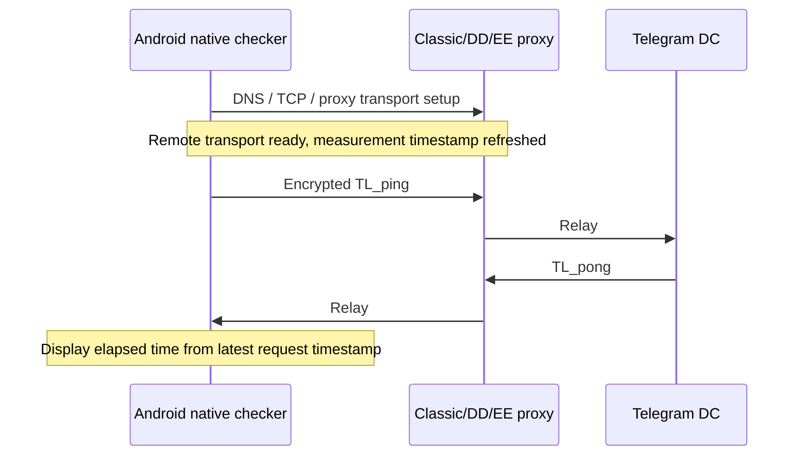
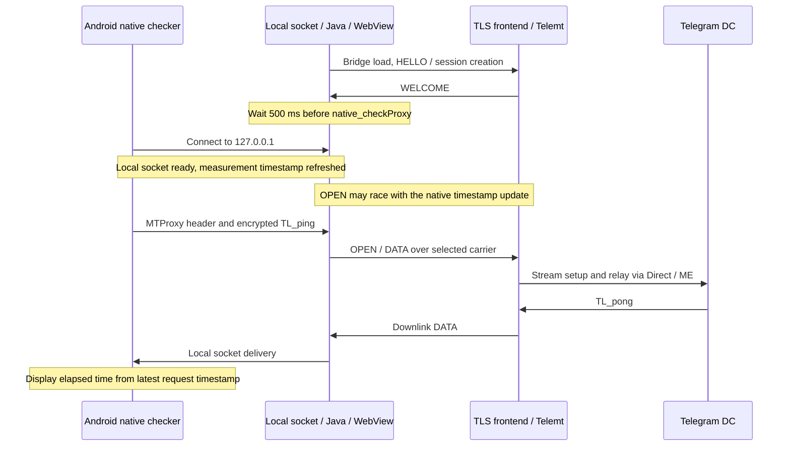
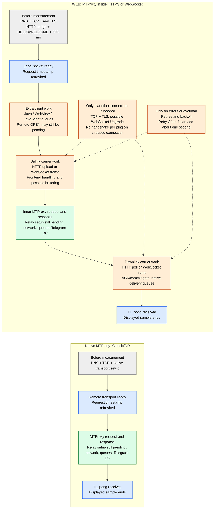

# Proxy-list ping: RPC Ping/Pong and WEB latency

[English](PROXY_PING.en.md) | [Русский](PROXY_PING.ru.md) | [Deutsch](PROXY_PING.de.md)

The reported **1000–1500 ms for WEB versus 50–150 ms for Classic/DD/EE** can compare different measurement boundaries. Android's WEB checker sees a local socket become ready before the remote WEB stream is necessarily ready. Remaining stream setup and carrier work can therefore enter the displayed result. The code does not impose a fixed one-second penalty on every successful WEB ping.

These numbers are operator observations, not measurements reproduced for this document. Source inspection establishes mechanisms; it does not identify the cause of an individual deployment's delay.

## Clients and measurements

Checked on **2026-10-31** against DrKLO Android `3de37c8cfb039452be7398909461da6288babf15` and Telegram iOS `279f89e4d4f63f17227bf877dc3d8990f22ecd58`. Installed releases and forks may differ.

| Measurement | What it covers | WEB behavior |
| --- | --- | --- |
| Android proxy-list ping | Encrypted MTProto `TL_ping` / `TL_pong` through the checked proxy | Separate WEB test transport, then native checker through a local socket. |
| iOS proxy-list ping | `req_pq` / `resPQ` connectivity probe; timing starts at `connectionOpened` | `.web` entries are excluded from ping contexts; an inactive WEB row is shown as not tested. |
| ICMP ping | IP echo to the selected host, subject to ICMP routing and policy | Does not measure the application relay or Telegram DC. |
| WEB transport `FRAME_PING` / `FRAME_PONG` or WebSocket keepalive | Carrier/session liveness | Not Android's displayed MTProto result. |
| Telemt ME RPC Ping/Pong | One Telemt-to-ME writer path, including local queue/flush scheduling | Excludes the client, WebView and public TLS frontend. |

Sources: [Android entry point][android-entry], [native requests][android-native], [iOS filter][ios-filter], [iOS probe][ios-probe], [iOS UI][ios-ui]. The current iOS WEB row therefore cannot be interpreted using Android's WEB ping formula.

Android displays the last checker result, without a median or EMA, and skips a new check when the previous check is less than two minutes old. A connected row can still show that stored result: it is not continuous RTT monitoring of the active session. The WEB checker creates its own transport rather than directly reusing the active app transport. See [proxy-list refresh][android-ui] and [WEB transport][android-transport].

## Where Android starts and stops the clock

For Classic/DD/EE, the native connection-ready callback follows remote TCP and the applicable proxy transport setup, including EE FakeTLS. Request processing refreshes the timestamp before sending/re-sending the probe. The normal successful sample therefore excludes that initial transport establishment. It includes subsequent relay work and the response path. See [socket readiness][android-socket] and [request processing][android-native].

For WEB, bridge startup, its initial HTTPS load, HELLO/WELCOME and an additional **500 ms** wait precede `native_checkProxy`; that wait is not added to its reported ping. WELCOME confirms a WEB session, not a ready Telegram DC stream. The native checker then connects to `127.0.0.1`, whose readiness does not wait for remote OPEN completion. Java acceptance/OPEN and the native timestamp update can race. Only work still pending inside the measured interval contributes. See [test sequencing][android-tester], [local socket and WELCOME][android-transport], [server session creation][session] and [stream backend][backend].

The diagrams show the normal successful path, not a guarantee of event ordering across threads:

`TL_pong` completes the sample using the latest request timestamp. Force processing or resend can reset that timestamp, so the displayed value is not necessarily the full wall time of a failed/retried attempt. The checker uses an [existing DC authorization key][android-key]; do not count a complete new MTProto authorization-key exchange as an obligatory part of every check.

## What TLS contributes

The public TLS connection terminates at NGINX, HAProxy or Caddy. Telemt receives plain HTTP/1.1 on its private listener. Frontend HTTP/2 and the internal HTTP/1.1 hop are separate connections; their protocol versions need not match. EE FakeTLS is an MTProxy camouflage transport, not the browser's certificate-authenticated HTTPS connection. WEB carries plain/DD MTProxy streams; EE is not a WEB secret format. See the [WEB deployment guide](WEB_PROXY.en.md).

For a new connection without loss, the usual TCP handshake costs about one client-to-frontend RTT. A full TLS 1.3 handshake normally adds one RTT; a full TLS 1.2 handshake normally adds two. These are protocol-flight estimates excluding DNS, processing, certificate validation, scheduling and retransmissions, not a measured WEB latency budget. Resumption can change the exchange. See [TLS 1.3][tls13] and [TLS 1.2][tls12].

Initial bridge TLS normally occurs before Android's measurement. Additional HTTP connections or a WebSocket Upgrade can still occur inside it; connection reuse must be established from a trace. Persistent HTTPS and an established WebSocket do not perform a new TLS handshake for every ping. `cache: 'no-store'` controls caching, not TCP/TLS reuse. Neither disabling certificate checks nor enabling TLS 0-RTT is required to explain or diagnose this behavior. See [HTTP persistence][http1] and [bridge requests][request].

## Where WEB adds work compared with native MTProxy

The comparison below separates work before the Android timer from work that can enter the displayed sample. The baseline is Classic/DD over TCP. For EE, FakeTLS belongs to native transport setup. Box sizes and arrow lengths do not represent elapsed time.

**Gray:** work before the displayed sample. **Blue:** timer boundaries. **Green:** MTProxy relay/DC work present in both paths, whose actual cost can differ. **Orange:** WEB carrier and client work inside the sample. **Dashed arrows:** conditional connection setup or retries, not obligatory stages.

On a reused carrier, the conditional TCP/TLS/Upgrade cost disappears, while framing, HTTP or WebSocket handling and client queues remain. HTTP can overlap uplink and downlink; it does not necessarily add a whole RTT for every request. Polling wakes on data, and frontend buffering is deployment-dependent. Any delay from loss, congestion or upstream setup may also affect native MTProxy.

Thus the visible difference can include remaining WEB stream setup, additional connection setup, carrier handling and scheduling, plus retries when observed. It is not a fixed TLS surcharge or an arithmetic sum of all boxes. The initial real TLS handshake is shown outside the Android timer deliberately: it affects total time to check, but normally not the displayed sample. The separate checker transport also means that an active app connection does not guarantee a warm proxy-list check.

## HTTP, WebSocket and other delay sources

| Factor | Effect and evidence |
| --- | --- |
| HTTP uplink | The generated bridge offers `X-Telemt-Up-Window: 4`; the server accepts 1–4, with legacy fallback 1. Window 1 waits for an ACK before the next upload; window 4 permits bounded concurrency. Not all HTTP traffic is stop-and-wait. See [negotiation][runtime] and [session handler][session]. |
| First downlink | `/down` can start alongside `/up`; there is no unconditional extra sequential ACK RTT. Initial native delivery is gated by the first valid upload ACK/commit. Frames are delivered incrementally. See [conveyor][conveyor] and [downlink][downlink]. |
| Long polling | `long_poll_secs=25` bounds an empty wait. Available data wakes the poll immediately. Gaps between polls or occupied browser connection slots can still delay delivery. See [server polling][poll]. |
| Carrier sharing | `https` shares its upload queue; `https-lanes` separates logical lanes. WebSocket carries frames after Upgrade, without a POST per frame; `websocket-lanes` separates sockets. Shared network, flow-control and WebView resources remain. HTTP/2 multiplexes streams but does not remove all congestion or flow-control stalls. See [HTTP/2][http2] and the [carrier guide](WEB_PROXY.en.md). |
| Frontend buffering | Request/response buffering or missing streaming/Upgrade support can delay small messages. Compare with the existing NGINX example; preserve routing, authentication and limits. |
| Client scheduling | Java accept/read threads, UI dispatch, WebView/JavaScript and delivery back to native code add queues. CPU pressure, mobile power management and network transitions can amplify them. |
| Relay and network | Remaining stream admission, inner MTProxy handshake, Direct connection or ME registration, Telegram response, loss/retransmission and queue pressure can contribute. A ready WEB session does not prove a ready upstream. |
| Errors and retries | Telemt can return `503` with `Retry-After: 1`. The bridge honors it; other retry backoff starts at 250 ms and doubles up to 2000 ms plus jitter up to approximately 25%, within the retry budget. Retryable HTTP statuses include 408/429/502/503/504. A trace must show such events before attributing a one-second step to them. See [responses][response] and [retry logic][request]. |

Deadlines are not mandatory sleeps. The default 10 s bridge-request deadline, 90 s retry budget, 30 s stream-first-byte deadline and 10 s stream-handshake deadline must not be summed into normal ping. `carrier_probe_coalesce_ms=0` disables that optional coalescing delay. Carrier fallback deadlines affect failed attempts, not every successful exchange. See [timeout defaults](../../src/config/types/web/defaults.rs).

A conceptual WEB sample is **remaining setup + carrier/network transit + queues + Telegram response + any retry delays still inside the timer**. These stages overlap; adding all configured timeouts or counting one RTT per HTTP endpoint is incorrect. Warm carriers can reduce setup costs, but the Android proxy checker still uses a separate transport. WebSocket is not universally faster; use only carriers supported by the actual client. The current iOS compatibility configuration uses `https`.

## Diagnosis without changing protections

1. Record client/build, Android WebView version, carrier, public endpoint, IP family, network, Direct/ME route, DC and load. Match these conditions for comparison. Respect Android's two-minute cached result; do not treat repeated UI reads as new samples.
2. Separate three experiments: a new proxy-list check; a new logical stream on a ready carrier; application RPC on an established MTProto session. The latter two require suitable client instrumentation and are not automatically provided by the proxy-list display. Record individual samples and distributions rather than comparing one cold sample with one warm sample.
3. Use the authenticated `GET /web-status` and existing `[web.debug]` controls with `capture_timings=true`, `capture_frames=true`, `body_capture="metadata"`. Enable bounded capture as described in the [WEB diagnostics guide](WEB_PROXY.en.md), then restore its prior state. Payloads, capabilities and secrets are unnecessary for this investigation.
4. Correlate session creation, carrier selection/commit/failure, `stream_admitted`, `stream_first_byte`, `handshake_succeeded`, OPEN/DATA, HTTP status and retries. `relay_started` precedes upstream work and is not a DC-ready timestamp. Use `GET /v1/runtime/web/status` and `GET /v1/runtime/web/sessions` for capacity and queue-pressure context, not end-to-end RTT.
5. Interpret `request_body_us`, `response_ready_us` and `response_body_us` as offsets from service entry. They are not independent durations to add, nor timestamps of wire flush or peer TCP ACK. Compare offsets only where recorded and meaningful. See [trace timing definitions][timings].
6. Add frontend connection/TLS/request timing and client timestamps to locate delays outside Telemt. Establish connection reuse, negotiated HTTP version, buffering and Upgrade behavior. Bridge startup/HELLO sideband events do not provide a complete client timeline. Synchronize clocks for cross-host comparisons or use durations on each host.
7. If ME is involved, compare the existing `ME RTT sample` trace (`rtt_ms`, `ema_ms`, `base_ms`, `degraded`). The timestamp precedes the writer queue/flush, and the EMA uses 80% previous value plus 20% new sample. Keepalive scheduling before that timestamp is excluded. A low ME value with high Android ping points to work outside that measured ME segment, without identifying one particular cause. See [writer][writer] and [reader][reader].

Evidence patterns: fast Telemt handling with late client delivery suggests investigating frontend/network/client queues; `503` plus `Retry-After: 1` supports a retry delay; long upstream work calls for Direct/ME investigation. None alone proves that TLS cryptography causes 1000–1500 ms. Keep compatibility, certificate verification, admission limits and backpressure intact while collecting evidence.

## Evidence scope

This document describes inspected source behavior, not an end-to-end device benchmark. Android/iOS links pin the revisions above; Telemt links refer to the accompanying working-tree implementation, including local WEB changes, rather than claiming every published package has identical behavior. No client, server, timeout or security setting is changed by this documentation.

[android-entry]: https://github.com/DrKLO/Telegram/blob/3de37c8cfb039452be7398909461da6288babf15/TMessagesProj/src/main/java/org/telegram/tgnet/ConnectionsManager.java#L752-L765
[android-tester]: https://github.com/DrKLO/Telegram/blob/3de37c8cfb039452be7398909461da6288babf15/TMessagesProj/src/main/java/org/telegram/utils/proxy/WebProxyConnectionTester.java#L111-L172
[android-transport]: https://github.com/DrKLO/Telegram/blob/3de37c8cfb039452be7398909461da6288babf15/TMessagesProj/src/main/java/org/telegram/utils/proxy/WebProxyTransport.java
[android-native]: https://github.com/DrKLO/Telegram/blob/3de37c8cfb039452be7398909461da6288babf15/TMessagesProj/jni/tgnet/ConnectionsManager.cpp
[android-socket]: https://github.com/DrKLO/Telegram/blob/3de37c8cfb039452be7398909461da6288babf15/TMessagesProj/jni/tgnet/ConnectionSocket.cpp
[android-key]: https://github.com/DrKLO/Telegram/blob/3de37c8cfb039452be7398909461da6288babf15/TMessagesProj/jni/tgnet/Datacenter.cpp#L1312-L1323
[android-ui]: https://github.com/DrKLO/Telegram/blob/3de37c8cfb039452be7398909461da6288babf15/TMessagesProj/src/main/java/org/telegram/ui/ProxyListActivity.java#L671-L687
[ios-filter]: https://github.com/TelegramMessenger/Telegram-iOS/blob/279f89e4d4f63f17227bf877dc3d8990f22ecd58/submodules/TelegramCore/Sources/Network/ProxyServersStatuses.swift#L54-L65
[ios-probe]: https://github.com/TelegramMessenger/Telegram-iOS/blob/279f89e4d4f63f17227bf877dc3d8990f22ecd58/submodules/MtProtoKit/Sources/MTProxyConnectivity.m#L57-L99
[ios-ui]: https://github.com/TelegramMessenger/Telegram-iOS/blob/279f89e4d4f63f17227bf877dc3d8990f22ecd58/submodules/SettingsUI/Sources/Data%20and%20Storage/ProxyListSettingsController.swift#L273-L310
[tls13]: https://datatracker.ietf.org/doc/html/rfc8446#section-2
[tls12]: https://datatracker.ietf.org/doc/html/rfc5246#section-7.3
[http1]: https://www.rfc-editor.org/rfc/rfc9112#section-9.3
[http2]: https://datatracker.ietf.org/doc/html/rfc9113#section-5
[session]: ../../src/web/http/session.rs
[backend]: ../../src/web/session/backend.rs
[runtime]: ../../src/web/bridge/runtime.js
[conveyor]: ../../src/web/bridge/conveyor.js
[downlink]: ../../src/web/bridge/downlink.js
[poll]: ../../src/web/session/downlink.rs
[request]: ../../src/web/bridge/request.js
[response]: ../../src/web/http/response.rs
[timings]: ../../src/web/trace/types.rs
[writer]: ../../src/transport/middle_proxy/pool_writer.rs
[reader]: ../../src/transport/middle_proxy/reader.rs
